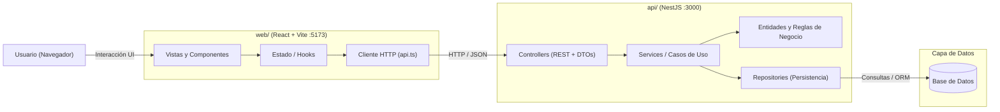
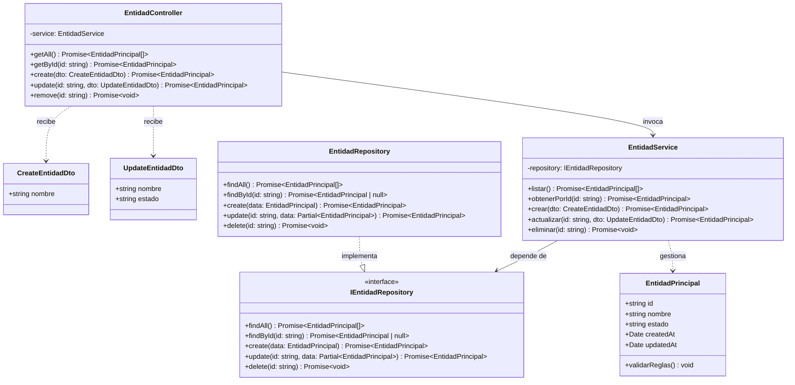
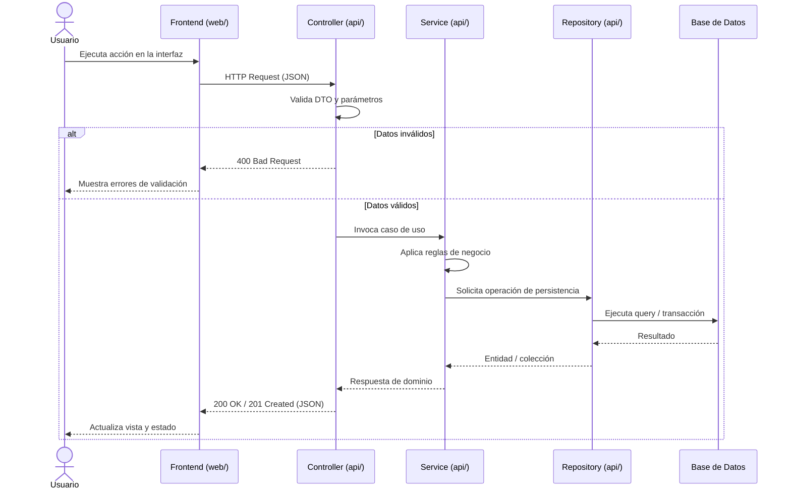
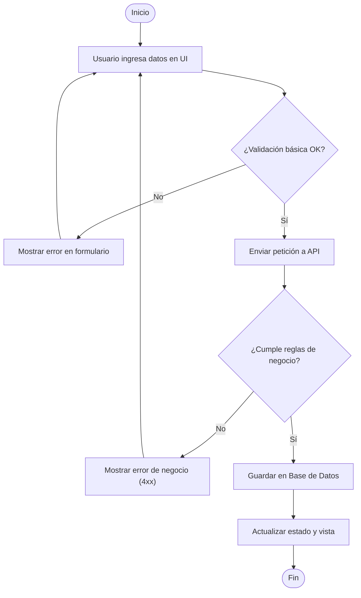

# Arquitectura del Sistema

> Documento de diseño arquitectónico para el proyecto full-stack (`api/` en NestJS + `web/` en React/Vite).

## 1. Visión General y Decisiones Técnicas

### Stack Tecnológico

| Capa | Tecnología | Ubicación | Puerto |
| --- | --- | --- | :---: |
| Frontend | React 19 + Vite 8 + TypeScript | `web/` | `5173` |
| Backend | NestJS 12 + Express + TypeScript | `api/` | `3000` |
| Pruebas | Vitest + Supertest | `api/` | — |
| Linter | oxlint | `api/` y `web/` | — |
| Base de Datos | _[Por definir: PostgreSQL / SQLite / etc.]_ | _[Local / Docker]_ | — |

### Decisiones de Arquitectura (ADRs)

1. **Separación por capas en `api/`:** _[Ej. Arquitectura modular por dominio (controllers -> services/use-cases -> repositories -> entities/DTOs)]_.
2. **Estructura en `web/`:** _[Ej. Organización por features/páginas, servicios HTTP desacoplados y tipos compartidos]_.
3. **Comunicación:** API REST sobre HTTP/JSON con CORS restringido a `WEB_ORIGIN`.
4. **Manejo de errores y validación:** _[Ej. ValidationPipe global + filtro de excepciones HTTP consistentes]_.

---

## 2. Diagrama de Arquitectura

---

## 3. Diagrama de Clases

> Plantilla base orientada a capas. Reemplazar `EntidadPrincipal` y sus propiedades/métodos con las entidades reales del dominio una vez definidos los requerimientos.

---

## 4. Diagramas de Flujo

### 4.1 Flujo general de una petición (Secuencia)

### 4.2 Flujo funcional principal (Actividad)

> Reemplazar los pasos con el flujo clave del dominio (por ejemplo: registro, aprobación, reserva, compra, etc.).

---

## 5. Contratos de API (Endpoints)

| Método | Ruta | Descripción | Request Body / Query | Respuestas |
| :---: | --- | --- | --- | --- |
| `GET` | `/health` _(o `/`)_ | Verificación de estado de la API | — | `200 OK` |
| `GET` | `/api/v1/[recurso]` | Listar registros | `?page=&limit=` | `200 OK` |
| `GET` | `/api/v1/[recurso]/:id` | Obtener detalle por ID | — | `200 OK`, `404 Not Found` |
| `POST` | `/api/v1/[recurso]` | Crear registro | `CreateDto` | `201 Created`, `400 Bad Request` |
| `PATCH` | `/api/v1/[recurso]/:id` | Actualizar registro | `UpdateDto` | `200 OK`, `400`, `404` |
| `DELETE` | `/api/v1/[recurso]/:id` | Eliminar registro | — | `204 No Content`, `404` |
