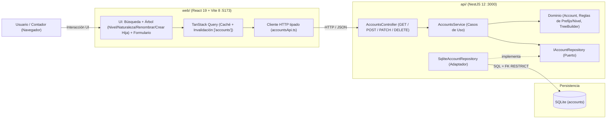
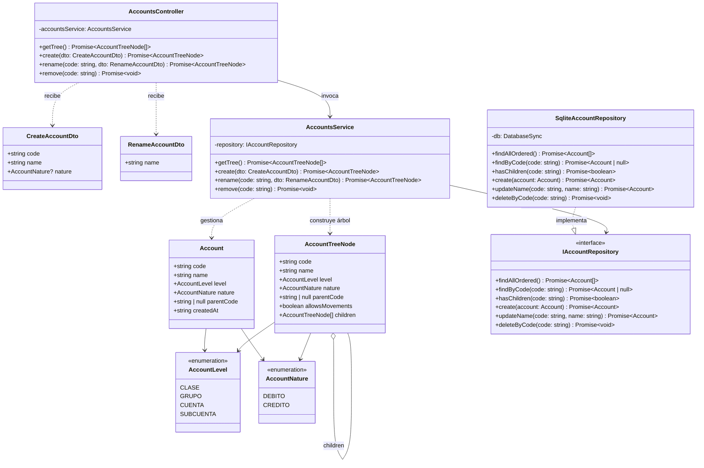
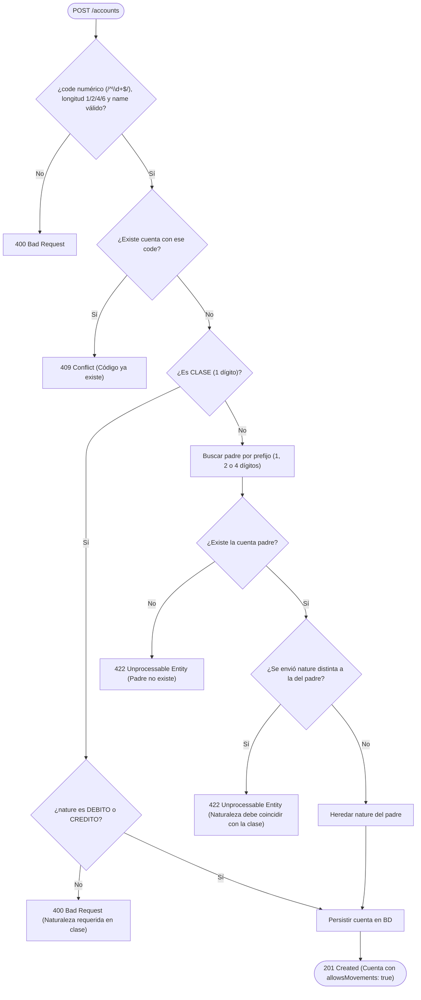
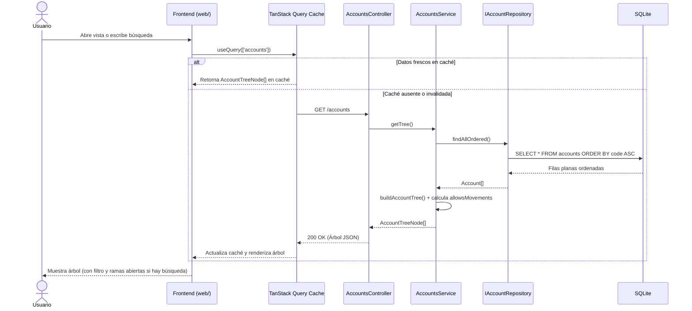
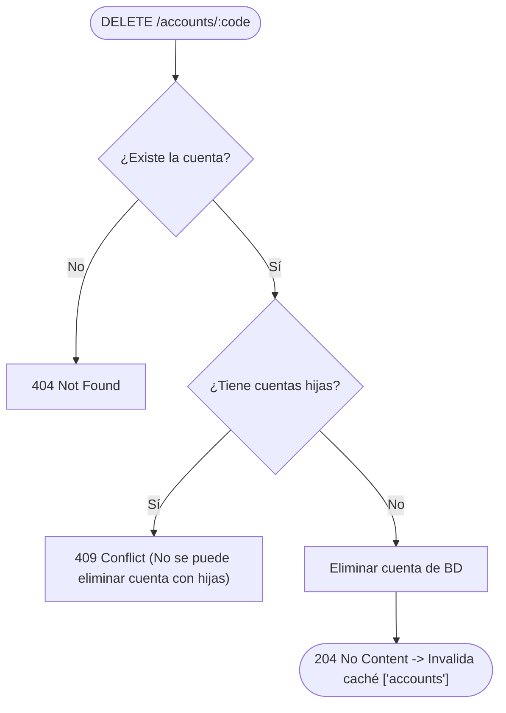
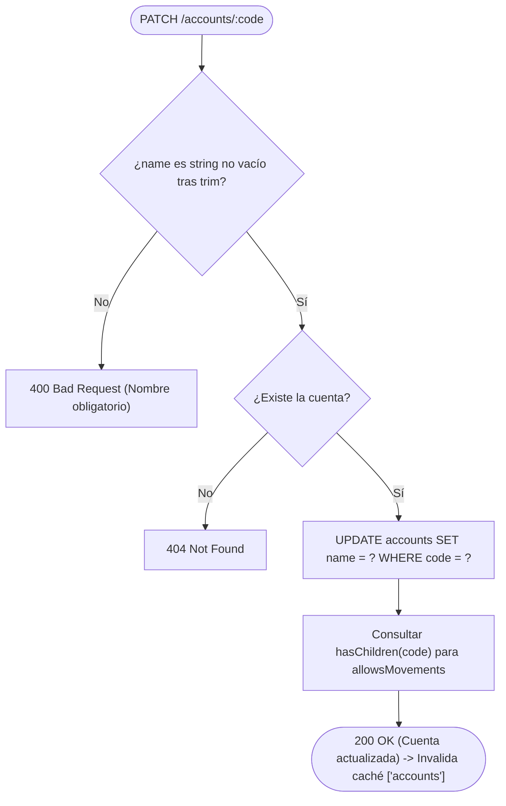

# Arquitectura del Sistema — Catálogo de Cuentas

> Diseño arquitectónico, decisiones técnicas, diagrama de arquitectura, diagrama de clases, diagramas de flujo y contratos REST (core + opcionales) para `api/` y `web/`.

## 1. Visión General y Decisiones Técnicas

### Stack Tecnológico

| Capa | Tecnología | Ubicación | Puerto |
| --- | --- | --- | :---: |
| Frontend | React 19 + Vite 8 + TypeScript + TanStack Query | `web/` | `5173` |
| Backend | NestJS 12 + Express + TypeScript | `api/` | `3000` |
| Base de Datos | SQLite (`node:sqlite`, esquema SQL portable) | `api/data/catalog.db` | — |
| Pruebas | Vitest + Supertest | `api/` | — |
| Linter | oxlint | `api/` y `web/` | — |

### Decisiones de Arquitectura (ADRs)

1. **Arquitectura por capas en `api/src/accounts/`:**
   - `domain/`: Entidad `Account`, enums (`AccountLevel`, `AccountNature`), reglas puras de negocio (nivel por longitud, `parentCode` por prefijo, herencia de naturaleza, `buildAccountTree`) y puerto `IAccountRepository`.
   - `application/`: `AccountsService` orquesta los casos de uso (`getTree`, `create`, `rename`, `remove`) con excepciones HTTP semánticas.
   - `infrastructure/`: `SqliteAccountRepository` e `InMemoryAccountRepository`.
   - `presentation/`: `AccountsController` y DTOs (`CreateAccountDto`, `RenameAccountDto`).
2. **Construcción del árbol en $O(n)$:** `GET /accounts` obtiene la lista ordenada por `code` en una consulta SQL y construye el árbol en memoria calculando `allowsMovements = node.children.length === 0`.
3. **Gestión de estado remoto con caché e invalidación en `web/`:** Uso de **TanStack Query** (`QueryClientProvider`, `useQuery(['accounts'])`, `useMutation` + `invalidateQueries(['accounts'])`) para eliminar recargas manuales, deduplicar peticiones y sincronizar la vista tras crear, renombrar o eliminar cuentas.
4. **Búsqueda y auto-expansión en cliente:** El filtrado por código o nombre opera sobre el árbol cacheado, calculando los códigos ancestros de cada coincidencia para abrir automáticamente solo las ramas relevantes.

---

## 2. Diagrama de Arquitectura



---

## 3. Diagrama de Clases



---

## 4. Diagramas de Flujo

### 4.1 Flujo de Creación de Cuenta (`POST /accounts`)



### 4.2 Flujo de Consulta en Árbol y Caché (`GET /accounts`)



### 4.3 Flujo de Eliminación de Cuenta (`DELETE /accounts/:code`)



### 4.4 Flujo de Renombrado de Cuenta (`PATCH /accounts/:code`)



---

## 5. Contratos de API (Endpoints)

Base URL local: `http://localhost:3000`

| Método | Ruta | Descripción | Respuestas |
| :---: | --- | --- | --- |
| `GET` | `/accounts` | Devuelve el catálogo completo como árbol anidado. | `200 OK` |
| `POST` | `/accounts` | Crea una nueva cuenta aplicando todas las reglas del catálogo. | `201 Created`, `400 Bad Request`, `409 Conflict`, `422 Unprocessable Entity` |
| `PATCH` | `/accounts/:code` | Renombra una cuenta existente sin modificar código, nivel ni naturaleza. | `200 OK`, `400 Bad Request`, `404 Not Found` |
| `DELETE` | `/accounts/:code` | Elimina una cuenta si no tiene hijas. | `204 No Content`, `404 Not Found`, `409 Conflict` |

### `POST /accounts`

**Request Body (Clase — 1 dígito):**
```json
{
  "code": "1",
  "name": "Activo",
  "nature": "DEBITO"
}
```

**Request Body (Grupo / Cuenta / Subcuenta — `nature` opcional, se hereda del padre):**
```json
{
  "code": "1105",
  "name": "Caja"
}
```

**Response `201 Created`:**
```json
{
  "code": "1105",
  "name": "Caja",
  "level": "CUENTA",
  "nature": "DEBITO",
  "parentCode": "11",
  "allowsMovements": true,
  "children": []
}
```

### `PATCH /accounts/:code`

**Request Body:**
```json
{
  "name": "Caja principal"
}
```

**Response `200 OK`:**
```json
{
  "code": "1105",
  "name": "Caja principal",
  "level": "CUENTA",
  "nature": "DEBITO",
  "parentCode": "11",
  "allowsMovements": false,
  "children": []
}
```

> Nota: `PATCH /accounts/:code` retorna los metadatos actualizados del nodo (con `allowsMovements` consistente). El frontend invalida la query `['accounts']` para reflejar el cambio en el árbol completo.

### `GET /accounts`

**Response `200 OK`:** Arreglo recursivo de `AccountTreeNode[]` ordenado ascendentemente por `code`.

### Formato de Error Estándar (NestJS)

```json
{
  "statusCode": 409,
  "message": "No se puede eliminar la cuenta '1105' porque tiene cuentas hijas.",
  "error": "Conflict"
}
```
