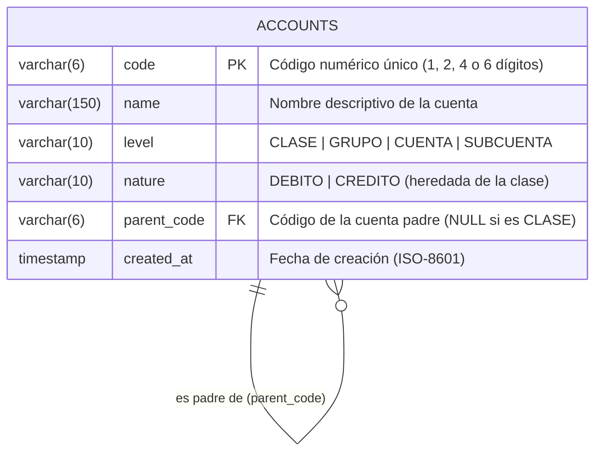

# Diseño de Base de Datos — Catálogo de Cuentas

> Modelado relacional, diagrama Entidad-Relación (ERD), restricciones de integridad y estrategia de persistencia.

## 1. Motor y Estrategia de Persistencia

- **Motor seleccionado:** **SQLite** (archivo local persistente en `api/data/catalog.db`, y `:memory:` para pruebas automatizadas).
- **Desacoplamiento:** Toda interacción con la base de datos se encapsula detrás de la interfaz de repositorio `IAccountRepository`, permitiendo cambiar a PostgreSQL u otro motor sin modificar la lógica de dominio ni los controladores.
- **Justificación:**
  - Cero dependencias de infraestructura externa (no requiere Docker ni servidor de BD para correr `npm run dev` o `npm test`).
  - Soporta restricciones relacionales nativas (`PRIMARY KEY`, `FOREIGN KEY ... ON DELETE RESTRICT`, `CHECK`) que refuerzan las reglas de negocio directamente en el motor de datos.
  - Esquema SQL estándar 100% portable a PostgreSQL.

---

## 2. Diagrama Entidad-Relación (ERD)

La jerarquía del catálogo se modela mediante una relación **autoreferenciada (adjacency list)** en la tabla `accounts`, donde `parent_code` apunta a `accounts.code`.



> **Nota sobre `allowsMovements`:** No se persiste como columna mutable para evitar estados inconsistentes. Se calcula dinámicamente al construir el árbol (`children.length === 0`) o mediante consulta de existencia de hijas (`NOT EXISTS (SELECT 1 FROM accounts WHERE parent_code = a.code)`).

---

## 3. Diccionario de Datos

### Tabla: `accounts`

| Columna | Tipo SQL | Restricciones | Descripción |
| --- | --- | --- | --- |
| `code` | `VARCHAR(6)` | `PRIMARY KEY, NOT NULL` | Código numérico único (`^\d+$`, longitud `1`, `2`, `4` o `6`). |
| `name` | `VARCHAR(150)` | `NOT NULL` | Nombre de la cuenta contable (sin espacios vacíos). |
| `level` | `VARCHAR(10)` | `NOT NULL, CHECK (level IN ('CLASE', 'GRUPO', 'CUENTA', 'SUBCUENTA'))` | Nivel jerárquico derivado de la longitud de `code`. |
| `nature` | `VARCHAR(10)` | `NOT NULL, CHECK (nature IN ('DEBITO', 'CREDITO'))` | Naturaleza contable definida en `CLASE` y heredada por descendientes. |
| `parent_code` | `VARCHAR(6)` | `NULL, FOREIGN KEY REFERENCES accounts(code) ON DELETE RESTRICT` | Código del padre inmediato (`NULL` únicamente cuando `level = 'CLASE'`). |
| `created_at` | `TEXT` | `NOT NULL, DEFAULT (datetime('now'))` | Marca de tiempo de creación en formato ISO-8601 UTC. |

---

## 4. DDL de Referencia e Índices

```sql
PRAGMA foreign_keys = ON;

CREATE TABLE IF NOT EXISTS accounts (
    code        VARCHAR(6)   PRIMARY KEY,
    name        VARCHAR(150) NOT NULL,
    level       VARCHAR(10)  NOT NULL CHECK (level IN ('CLASE', 'GRUPO', 'CUENTA', 'SUBCUENTA')),
    nature      VARCHAR(10)  NOT NULL CHECK (nature IN ('DEBITO', 'CREDITO')),
    parent_code VARCHAR(6)   NULL,
    created_at  TEXT         NOT NULL DEFAULT (datetime('now')),
    CONSTRAINT fk_accounts_parent
        FOREIGN KEY (parent_code)
        REFERENCES accounts(code)
        ON DELETE RESTRICT
        ON UPDATE RESTRICT,
    CONSTRAINT chk_accounts_code_length
        CHECK (length(code) IN (1, 2, 4, 6)),
    CONSTRAINT chk_accounts_parent_by_level
        CHECK (
            (level = 'CLASE' AND parent_code IS NULL)
            OR (level <> 'CLASE' AND parent_code IS NOT NULL)
        )
);

CREATE INDEX IF NOT EXISTS idx_accounts_parent_code
    ON accounts(parent_code);
```

### Índices y Garantías de Integridad
- **Llave primaria (`code`):** Garantiza unicidad global del código (`RN-02`) y búsquedas $O(\log n)$ por código exacto.
- **Índice `idx_accounts_parent_code`:** Acelera la verificación de existencia de hijas al eliminar (`RN-06`) y el agrupamiento de nodos al armar el árbol.
- **`ON DELETE RESTRICT`:** Segunda barrera de seguridad a nivel de base de datos que impide eliminar una cuenta con hijas incluso ante accesos concurrentes.
- **Actualización segura (`PATCH /accounts/:code`):** La operación de renombrado ejecuta exclusivamente `UPDATE accounts SET name = ? WHERE code = ?`, garantizando inmutabilidad de `code`, `level`, `nature` y `parent_code`.

---

## 5. Estrategia de Inicialización, Seeds y Pruebas

- **Inicialización de esquema:** Al arrancar la aplicación, el proveedor de base de datos habilita `PRAGMA foreign_keys = ON` y ejecuta la creación idempotente de la tabla e índice (`CREATE TABLE IF NOT EXISTS`).
- **Datos iniciales (Seeds):** La base arranca vacía por defecto para permitir probar la creación desde clases raíz (`1`, `2`, etc.). Opcionalmente se puede incluir un script de seed con un plan mínimo de ejemplo (`1 Activo`, `11 Disponible`, `1105 Caja`, `110505 Caja general`).
- **Pruebas automatizadas:** Las pruebas unitarias usan un repositorio en memoria (`InMemoryAccountRepository`) y las pruebas e2e usan SQLite en memoria (`:memory:`) aislado por suite.
