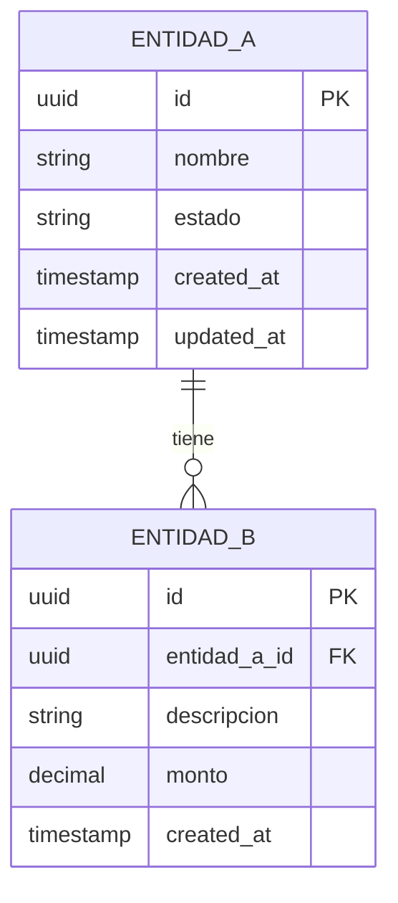

# Diseño de Base de Datos

> Documento de modelado de datos, relaciones, restricciones y estrategia de persistencia.

## 1. Motor y Estrategia de Persistencia

- **Motor seleccionado:** _[Por definir: PostgreSQL / SQLite / MySQL / MongoDB]_
- **ORM / Query Builder:** _[Por definir: Prisma / TypeORM / Drizzle / Knex]_
- **Justificación:** _[Explicar por qué se elige esta opción frente a alternativas]_

---

## 2. Diagrama Entidad-Relación (ERD)

> Plantilla inicial. Reemplazar entidades, atributos y cardinalidades según el dominio del proyecto.

---

## 3. Diccionario de Datos

### Tabla: `entidad_a` _(plantilla)_

| Columna | Tipo | Restricciones | Descripción |
| --- | --- | --- | --- |
| `id` | `UUID` | `PK, NOT NULL` | Identificador único del registro |
| `nombre` | `VARCHAR(120)` | `NOT NULL` | Nombre descriptivo |
| `estado` | `VARCHAR(30)` | `NOT NULL, DEFAULT 'ACTIVO'` | Estado actual dentro del flujo |
| `created_at` | `TIMESTAMP` | `NOT NULL, DEFAULT NOW()` | Fecha de creación |
| `updated_at` | `TIMESTAMP` | `NOT NULL, DEFAULT NOW()` | Fecha de última actualización |

### Tabla: `entidad_b` _(plantilla)_

| Columna | Tipo | Restricciones | Descripción |
| --- | --- | --- | --- |
| `id` | `UUID` | `PK, NOT NULL` | Identificador único del registro |
| `entidad_a_id` | `UUID` | `FK -> entidad_a(id), NOT NULL` | Relación con `entidad_a` |
| `descripcion` | `TEXT` | `NULL` | Detalle adicional |
| `monto` | `DECIMAL(12,2)` | `NOT NULL, CHECK (monto >= 0)` | Valor numérico asociado |
| `created_at` | `TIMESTAMP` | `NOT NULL, DEFAULT NOW()` | Fecha de creación |

---

## 4. Índices y Restricciones

- **Llaves únicas:** _[Ej. `UNIQUE (email)`]_
- **Índices de consulta frecuente:** _[Ej. `INDEX idx_entidad_b_entidad_a_id ON entidad_b(entidad_a_id)`]_
- **Integridad referencial:** _[Definir comportamiento `ON DELETE` / `ON UPDATE` (RESTRICT, CASCADE, SET NULL)]_

---

## 5. Migraciones, Seeds y Transacciones

- **Migraciones:** _[Comandos para generar y aplicar migraciones]_
- **Datos iniciales (Seeds):** _[Qué datos de prueba o catálogos se cargan al iniciar]_
- **Transacciones:** _[Operaciones que requieren atomicidad ACID]_
