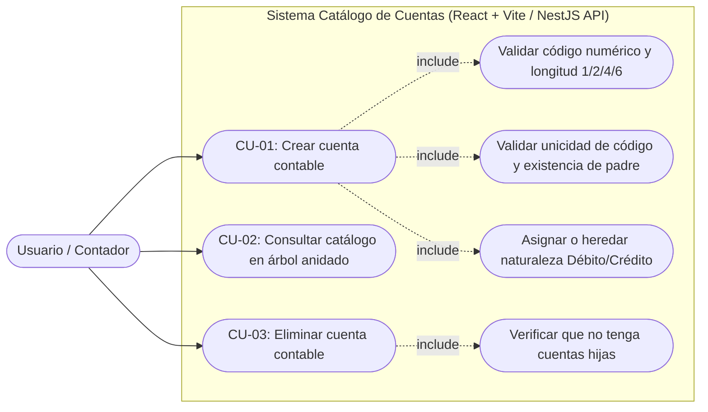

# Requerimientos del Proyecto — Catálogo de Cuentas

> Especificación funcional, reglas de negocio, diagrama de casos de uso y criterios de aceptación para el sistema de **Catálogo de Cuentas Contables**.

## 1. Contexto y Objetivo

- **Nombre del proyecto:** Catálogo de Cuentas (Plan de Cuentas Jerárquico)
- **Problema a resolver:** Gestionar un catálogo de cuentas contables organizado como una lista jerárquica que permita clasificar registros contables garantizando integridad estructural, unicidad de códigos y herencia de naturaleza contable.
- **Objetivo principal:** Permitir a los usuarios crear cuentas respetando la jerarquía por prefijo numérico, consultar el catálogo completo en formato de árbol anidado y eliminar cuentas hoja sin romper la integridad del árbol.

---

## 2. Actores / Roles

| Actor | Descripción | Acciones principales |
| --- | --- | --- |
| Usuario / Contador | Persona que administra y consulta el plan de cuentas desde la aplicación web. | Crear cuentas, consultar el catálogo jerárquico en árbol y eliminar cuentas sin hijas. |

---

## 3. Diagrama de Casos de Uso

---

## 4. Requerimientos Funcionales (RF)

| ID | Requerimiento | Prioridad | Criterio de aceptación |
| --- | --- | :---: | --- |
| RF-01 | **Crear cuenta contable** (`POST /accounts`) | P0 | Valida que `code` sea numérico y de longitud `1`, `2`, `4` o `6`; que `name` no esté vacío; que `code` no exista; que exista el padre correspondiente si no es clase; y asigna/hereda la `nature` (`DEBITO`/`CREDITO`). Retorna `201 Created` con la cuenta creada. |
| RF-02 | **Consultar catálogo como árbol anidado** (`GET /accounts`) | P0 | Retorna todas las cuentas estructuradas jerárquicamente desde las clases raíz hasta las subcuentas, ordenadas por código, indicando en cada nodo su nivel, naturaleza y si admite movimientos contables (`allowsMovements`). Retorna `200 OK`. |
| RF-03 | **Eliminar cuenta contable** (`DELETE /accounts/:code`) | P0 | Elimina la cuenta indicada si existe y no tiene cuentas hijas (`204 No Content`). Rechaza la eliminación si tiene al menos una cuenta hija (`409 Conflict`) o si no existe (`404 Not Found`). |

---

## 5. Reglas de Negocio (RN)

- **RN-01 (Clave y nombre):** Cada cuenta posee un código numérico (`code`) y un nombre (`name`) obligatorios.
- **RN-02 (Unicidad):** El código (`code`) es único en todo el catálogo. No se permiten duplicados.
- **RN-03 (Niveles por longitud del código):** La longitud del código determina automáticamente el nivel jerárquico:
  - `1` dígito → `CLASE`
  - `2` dígitos → `GRUPO`
  - `4` dígitos → `CUENTA`
  - `6` dígitos → `SUBCUENTA`
  - Cualquier otra longitud o carácter no numérico es inválido.
- **RN-04 (Relación padre-hijo por prefijo):** El padre de una cuenta es la cuenta cuyo código corresponde al prefijo del nivel inmediatamente anterior:
  - `6` dígitos → prefijo de `4` dígitos (ej. `110505` → padre `1105`)
  - `4` dígitos → prefijo de `2` dígitos (ej. `1105` → padre `11`)
  - `2` dígitos → prefijo de `1` dígito (ej. `11` → padre `1`)
  - `1` dígito (`CLASE`) → no tiene padre (`parentCode = null`).
- **RN-05 (Existencia obligatoria del padre):** No se puede crear una cuenta si su padre no existe previamente en el catálogo (aplica a `GRUPO`, `CUENTA` y `SUBCUENTA`).
- **RN-06 (Protección al eliminar):** No se puede eliminar una cuenta que tenga una o más cuentas hijas.
- **RN-07 (Admisión de movimientos contables):** Solo las cuentas **sin hijas** (nodos hoja) admiten movimientos contables (`allowsMovements = true`). Al agregarle una hija, pasa automáticamente a `allowsMovements = false`; si luego se eliminan todas sus hijas, vuelve a `allowsMovements = true`.
- **RN-08 (Naturaleza y herencia):** Cada `CLASE` debe especificar su naturaleza contable: `DEBITO` o `CREDITO`. Todos sus descendientes (`GRUPO`, `CUENTA`, `SUBCUENTA`) heredan automáticamente la naturaleza de su padre/clase. Si al crear una cuenta descendiente se envía una naturaleza explícita distinta a la del padre, la operación se rechaza.

---

## 6. Requerimientos No Funcionales (RNF)

| ID | Categoría | Requerimiento |
| --- | --- | --- |
| RNF-01 | Arquitectura | Separación clara por capas en `api/` (controladores, servicios/casos de uso, dominio puro, repositorios) y organización modular en `web/`. |
| RNF-02 | Calidad de código | Tipado estricto con TypeScript y cero errores de `oxlint` en `api/` y `web/`. |
| RNF-03 | Pruebas | Pruebas unitarias de reglas de dominio/árbol y pruebas de integración (e2e) de los endpoints con Vitest y Supertest. |
| RNF-04 | Usabilidad | Visualización clara del árbol de cuentas con expansión/colapso, distintivo de nivel/naturaleza/admisión de movimientos y mensajes claros de error. |
| RNF-05 | Integridad y validación | Validación de entradas en servidor y cliente, respuestas de error HTTP consistentes y CORS configurado hacia `WEB_ORIGIN`. |

---

## 7. Alcance

### Incluido (In Scope)
- Creación de cuentas con todas las validaciones estructurales y de negocio (`RN-01` a `RN-08`).
- Consulta del catálogo completo en formato de árbol anidado con propiedad calculada `allowsMovements`.
- Eliminación segura de cuentas hoja (bloqueando eliminación si tiene hijas).
- Persistencia relacional desacoplada detrás de una interfaz de repositorio.
- Pruebas automatizadas en backend.

### Excluido (Out of Scope / Mejoras futuras)
- Registro de asientos / movimientos contables (solo se modela y expone si la cuenta admite movimientos).
- Edición de nombre o recodificación de cuentas existentes.
- Autenticación, roles de usuario y multi-empresa.
- Importación/exportación masiva (CSV/Excel).

---

## 8. Supuestos y Restricciones

- **Stack base:** Backend en **NestJS 12** (`api/`, puerto `3000`) y Frontend en **React 19 + Vite 8** (`web/`, puerto `5173`).
- **Formato del código:** Se almacena y transporta como `string` de solo dígitos (`/^\d+$/`) para evitar pérdida de ceros a la izquierda y facilitar operaciones de longitud y prefijo.
- **Ordenamiento del árbol:** Los nodos en cada nivel del árbol se ordenan lexicográficamente ascendente por `code` (ej. `1`, `2`, `11`, `12`, `1105`, `1110`).
- **Naturaleza en descendientes:** El campo `nature` es obligatorio únicamente al crear una `CLASE` (1 dígito); en niveles inferiores es opcional porque se hereda automáticamente del padre (y si se envía, debe coincidir con la heredada).
