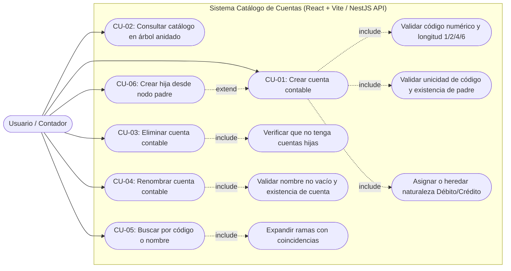

# Requerimientos del Proyecto — Catálogo de Cuentas

> Especificación funcional, reglas de negocio, diagrama de casos de uso y criterios de aceptación para el sistema de **Catálogo de Cuentas Contables** (funcionalidades base + opcionales).

## 1. Contexto y Objetivo

- **Nombre del proyecto:** Catálogo de Cuentas (Plan de Cuentas Jerárquico)
- **Problema a resolver:** Gestionar un catálogo de cuentas contables organizado como una lista jerárquica que permita clasificar registros contables garantizando integridad estructural, unicidad de códigos y herencia de naturaleza contable.
- **Objetivo principal:** Permitir a los usuarios crear cuentas (desde cero o como hijas de un nodo existente), consultar y buscar en el árbol jerárquico, renombrar cuentas y eliminar cuentas hoja sin romper la integridad del árbol.

---

## 2. Actores / Roles

| Actor | Descripción | Acciones principales |
| --- | --- | --- |
| Usuario / Contador | Persona que administra y consulta el plan de cuentas desde la aplicación web. | Crear cuentas, crear hijas desde el árbol, buscar por código/nombre, renombrar cuentas y eliminar cuentas sin hijas. |

---

## 3. Diagrama de Casos de Uso

---

## 4. Requerimientos Funcionales (RF)

### Core (Entregado)
| ID | Requerimiento | Prioridad | Criterio de aceptación |
| --- | --- | :---: | --- |
| RF-01 | **Crear cuenta contable** (`POST /accounts`) | P0 | Valida que `code` sea numérico y de longitud `1`, `2`, `4` o `6`; que `name` no esté vacío; que `code` no exista; que exista el padre correspondiente si no es clase; y asigna/hereda la `nature` (`DEBITO`/`CREDITO`). Retorna `201 Created`. |
| RF-02 | **Consultar catálogo como árbol anidado** (`GET /accounts`) | P0 | Retorna todas las cuentas estructuradas jerárquicamente desde las clases raíz hasta las subcuentas, ordenadas por código, indicando nivel, naturaleza y `allowsMovements`. Retorna `200 OK`. |
| RF-03 | **Eliminar cuenta contable** (`DELETE /accounts/:code`) | P0 | Elimina la cuenta indicada si existe y no tiene cuentas hijas (`204 No Content`). Rechaza si tiene hijas (`409 Conflict`) o no existe (`404 Not Found`). |

### Opcionales (Fase 5)
| ID | Requerimiento | Prioridad | Criterio de aceptación |
| --- | --- | :---: | --- |
| RF-04 | **Buscar por código o nombre en el árbol** | P1 | Al escribir un término de búsqueda, filtra/resalta las cuentas cuyo `code` o `name` coincida (insensible a mayúsculas/acentos) y expande automáticamente todas las ramas ancestras que contienen coincidencias. |
| RF-05 | **Crear hija desde el nodo padre con código prellenado** | P1 | En cada nodo de nivel `CLASE`, `GRUPO` o `CUENTA` existe una acción para crear una cuenta hija que abre/enfoca el formulario con `code` prellenado con el código del padre y muestra la naturaleza heredada. No se habilita en `SUBCUENTA` (nivel máximo de 6 dígitos). |
| RF-06 | **Renombrar una cuenta desde el árbol** (`PATCH /accounts/:code`) | P1 | Permite editar el `name` de cualquier cuenta existente desde su nodo en el árbol. Valida que el nuevo nombre no esté vacío (`400 Bad Request`) y que la cuenta exista (`404 Not Found`), retornando `200 OK` con la cuenta actualizada. |
| RF-07 | **Mostrar nivel y naturaleza de cada cuenta en el árbol** | P1 | Cada nodo visible en el árbol muestra de forma clara y diferenciada su nivel (`CLASE`, `GRUPO`, `CUENTA`, `SUBCUENTA`) y su naturaleza contable (`DEBITO` o `CREDITO`), además del estado de admisión de movimientos. |

---

## 5. Reglas de Negocio (RN)

- **RN-01 (Clave y nombre):** Cada cuenta posee un código numérico (`code`) y un nombre (`name`) obligatorios.
- **RN-02 (Unicidad):** El código (`code`) es único en todo el catálogo. No se permiten duplicados.
- **RN-03 (Niveles por longitud del código):** La longitud del código determina automáticamente el nivel jerárquico:
  - `1` dígito → `CLASE`
  - `2` dígitos → `GRUPO`
  - `4` dígitos → `CUENTA`
  - `6` dígitos → `SUBCUENTA`
  - Cualquier otra longitud o carácter no numérico es inválido.
- **RN-04 (Relación padre-hijo por prefijo):** El padre de una cuenta es la cuenta cuyo código corresponde al prefijo del nivel inmediatamente anterior (`110505 → 1105 → 11 → 1 → null`).
- **RN-05 (Existencia obligatoria del padre):** No se puede crear una cuenta si su padre no existe previamente en el catálogo (aplica a `GRUPO`, `CUENTA` y `SUBCUENTA`).
- **RN-06 (Protección al eliminar):** No se puede eliminar una cuenta que tenga una o más cuentas hijas.
- **RN-07 (Admisión de movimientos contables):** Solo las cuentas **sin hijas** (nodos hoja) admiten movimientos contables (`allowsMovements = true`).
- **RN-08 (Naturaleza y herencia):** Cada `CLASE` define su naturaleza (`DEBITO` o `CREDITO`) y todos sus descendientes la heredan automáticamente. Si al crear una descendiente se envía una naturaleza distinta a la del padre, se rechaza (`422`).
- **RN-09 (Renombrado seguro):** Renombrar una cuenta únicamente actualiza `name` (recortando espacios externos y validando que no quede vacío). Nunca modifica `code`, `level`, `parentCode` ni `nature`.
- **RN-10 (Profundidad máxima):** Las cuentas de nivel `SUBCUENTA` (6 dígitos) representan el nivel máximo del catálogo y no admiten cuentas hijas.

---

## 6. Requerimientos No Funcionales (RNF)

| ID | Categoría | Requerimiento |
| --- | --- | --- |
| RNF-01 | Arquitectura | Separación clara por capas en `api/` (`domain`, `application`, `infrastructure`, `presentation`) y organización modular en `web/`. |
| RNF-02 | Calidad de código | Tipado estricto con TypeScript y cero errores de `oxlint` en `api/` y `web/`. |
| RNF-03 | Pruebas | Pruebas unitarias y E2E en `api/` con Vitest y Supertest cubriendo creación, consulta, renombrado y eliminación. |
| RNF-04 | Usabilidad | Árbol claro con badges de nivel/naturaleza/movimientos, búsqueda con auto-expansión, acciones contextuales por nodo y feedback de carga/error. |
| RNF-05 | Integridad y validación | Validación de entradas en servidor y cliente, respuestas de error HTTP consistentes y CORS configurado hacia `WEB_ORIGIN`. |
| RNF-06 | Estado de servidor y caché | En `web/`, el estado remoto del catálogo se gestiona mediante caché e invalidación automática (**TanStack Query**) en lugar de recargas manuales con `useEffect`/`useState`. |

---

## 7. Alcance

### Incluido (In Scope)
- Creación, consulta en árbol, renombrado y eliminación de cuentas con todas las reglas (`RN-01` a `RN-10`).
- Búsqueda por código o nombre en el árbol con apertura automática de ramas coincidentes.
- Creación de cuenta hija desde el nodo padre con código prellenado.
- Visualización explícita de nivel (`CLASE`/`GRUPO`/`CUENTA`/`SUBCUENTA`) y naturaleza (`DEBITO`/`CREDITO`) en cada nodo.
- Gestión de estado del servidor en frontend con caché e invalidación (TanStack Query).
- Persistencia SQLite desacoplada y pruebas unitarias + E2E.

### Excluido (Out of Scope / Mejoras futuras)
- Registro de asientos / movimientos contables y saldos.
- Recodificación o movimiento de subárboles de una cuenta a otro padre.
- Autenticación, roles de usuario y multi-empresa.
- Importación/exportación masiva (CSV/Excel).

---

## 8. Supuestos y Restricciones

- **Stack base:** Backend en **NestJS 12** (`api/`, puerto `3000`) y Frontend en **React 19 + Vite 8 + TanStack Query** (`web/`, puerto `5173`).
- **Formato del código:** Se almacena y transporta como `string` de solo dígitos (`/^\d+$/`).
- **Ordenamiento del árbol:** Los nodos en cada nivel se ordenan lexicográficamente ascendente por `code`.
- **Búsqueda:** Se realiza sobre el árbol cacheado en el cliente para respuesta instantánea sin disparar peticiones por tecla.
