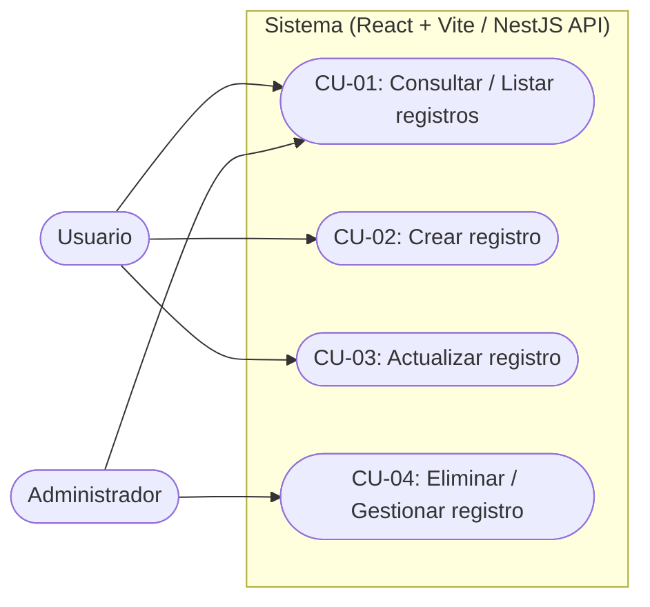

# Requerimientos del Proyecto

> Documento vivo para especificar qué debe resolver el sistema, sus reglas de negocio y criterios de aceptación.

## 1. Contexto y Objetivo

- **Nombre del proyecto:** _[Por definir]_
- **Problema a resolver:** _[Describir brevemente el problema o caso de uso de la prueba técnica]_
- **Objetivo principal:** _[Qué valor entrega la solución al usuario final]_

## 2. Actores / Roles

| Actor | Descripción | Acciones principales |
| --- | --- | --- |
| Usuario | _[Descripción del rol]_ | _[Acciones permitidas]_ |
| Administrador _(si aplica)_ | _[Descripción del rol]_ | _[Acciones permitidas]_ |

## 3. Diagrama de Casos de Uso

> Plantilla inicial en Mermaid. Reemplazar los casos de uso (`CU-01`..`CU-04`) y actores con las acciones reales del dominio.

## 4. Requerimientos Funcionales (RF)

| ID | Requerimiento | Prioridad | Criterio de aceptación |
| --- | --- | :---: | --- |
| RF-01 | _[Ej. Crear un registro de ...]_ | P0 | _[Ej. Al enviar datos válidos, persiste y retorna 201]_ |
| RF-02 | _[Ej. Listar y filtrar ...]_ | P0 | _[Ej. Muestra listado actualizado con filtros aplicados]_ |
| RF-03 | _[Ej. Actualizar estado o datos de ...]_ | P1 | _[Ej. Valida transición de estado y refleja cambios en UI]_ |
| RF-04 | _[Ej. Eliminar o archivar ...]_ | P1 | _[Ej. Confirma acción y actualiza el listado]_ |

## 5. Reglas de Negocio (RN)

- **RN-01:** _[Ej. Un registro no puede crearse sin ...]_
- **RN-02:** _[Ej. Solo se permite cambiar del estado A al estado B si ...]_
- **RN-03:** _[Ej. No pueden existir duplicados por ...]_

## 6. Requerimientos No Funcionales (RNF)

| ID | Categoría | Requerimiento |
| --- | --- | --- |
| RNF-01 | Arquitectura | Separación clara de responsabilidades entre presentación, lógica de negocio y persistencia. |
| RNF-02 | Calidad de código | Tipado estricto con TypeScript y cumplimiento de `oxlint` en `api/` y `web/`. |
| RNF-03 | Pruebas | Cobertura de pruebas unitarias e integración para la lógica crítica del backend con Vitest. |
| RNF-04 | Usabilidad | Interfaz clara con feedback visual de carga, error y estados vacíos. |
| RNF-05 | Seguridad y validación | Validación de entradas en cliente y servidor; manejo consistente de errores HTTP y CORS configurado. |

## 7. Alcance

### Incluido (In Scope)
- _[Listar funcionalidades que sí se implementarán]_

### Excluido (Out of Scope / Mejoras futuras)
- _[Listar funcionalidades que quedan fuera por tiempo o alcance y se documentarán en el README final]_

## 8. Supuestos y Restricciones

- **Stack base:** Backend en NestJS (`api/`, puerto `3000`) y Frontend en React + Vite (`web/`, puerto `5173`).
- **Entorno:** Node 22 y npm >= 10.
- **Supuestos adicionales:** _[Agregar supuestos que se tomen ante ambigüedades del enunciado]_
